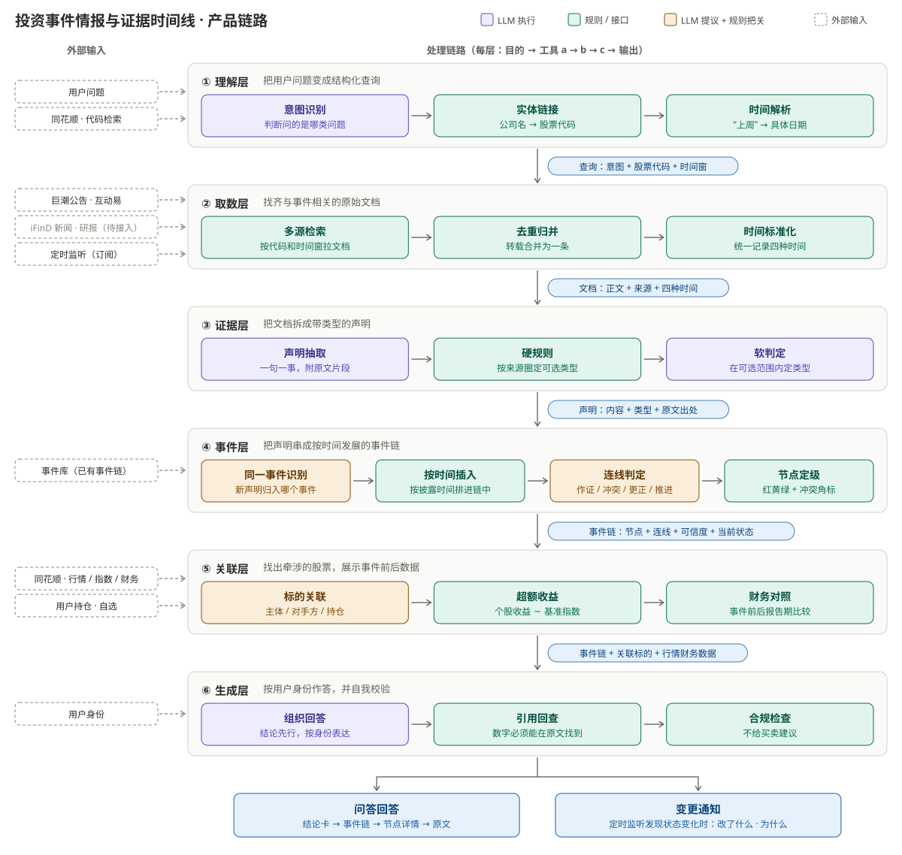
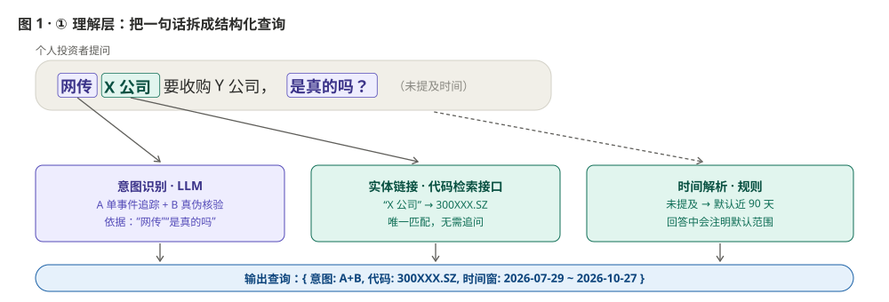
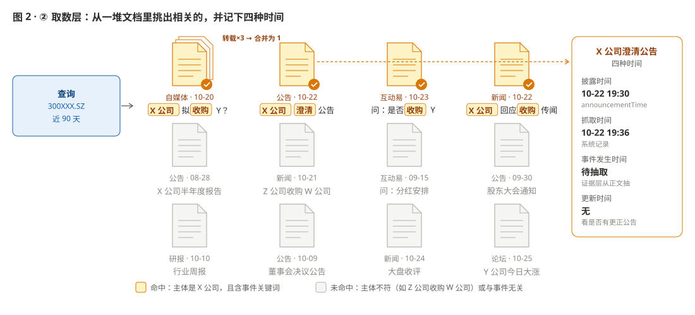
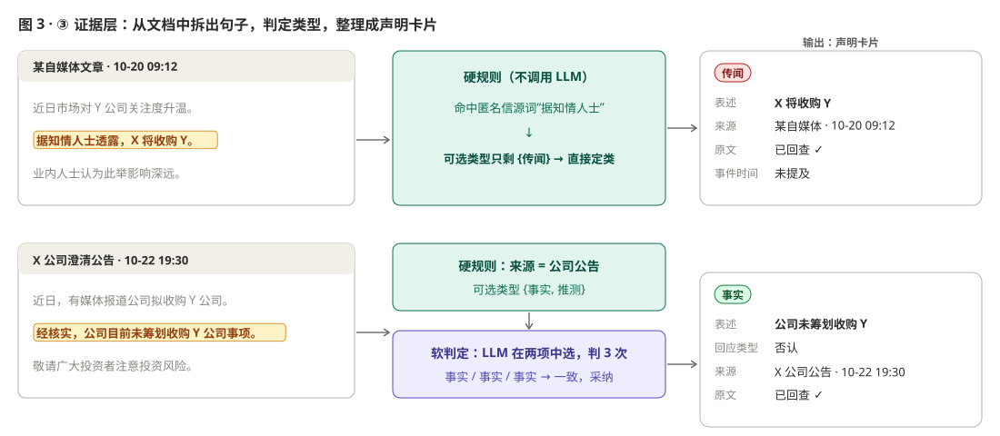
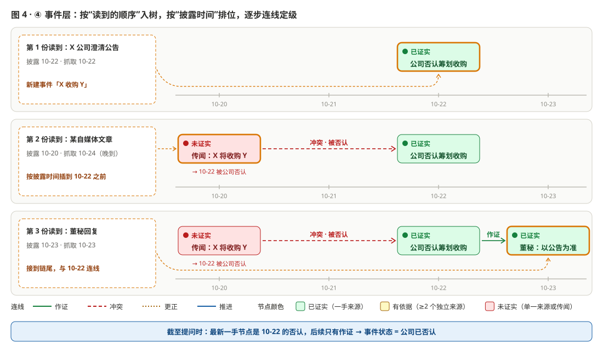
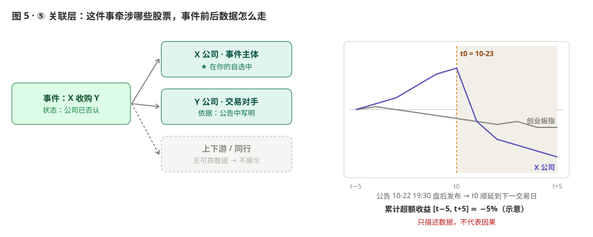
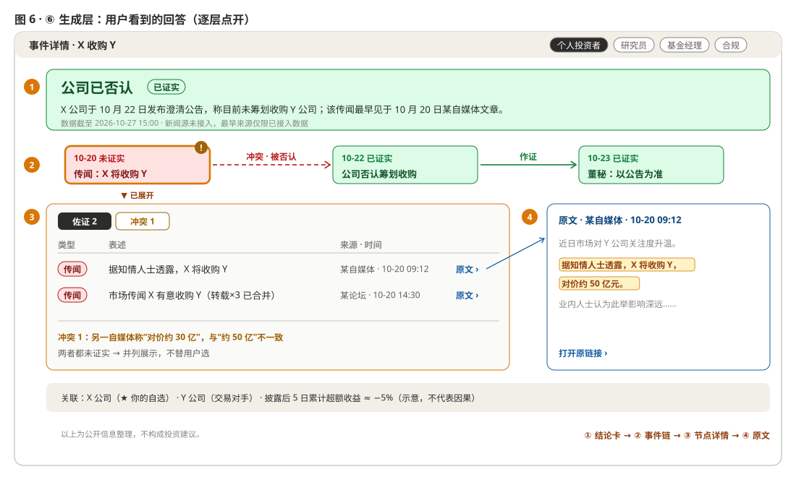

# 投资事件情报与证据时间线 · 产品设计

> v1.3 · 2026-10-28 · 数据接口状态以 2026-10-27 实测为准 · 新增第 14 节：对话式交互、话题更新推送、身份视角与读者表达



---

## 0. 一分钟读懂

**这个产品做什么**：用户拿着一条消息来问，产品把散落在公告、董秘回复、新闻、研报里的信息，整理成**一条按时间发展的事件链**。链上每个节点标出红、黄、绿三档可信度，点开可以看到证据和冲突，再点一层就能看到原文。

**怎么做到**：问题依次经过六层，每一层的输出就是下一层的输入。

```
① 理解 →查询→ ② 取数 →文档→ ③ 证据 →声明→ ④ 事件 →事件链→ ⑤ 关联 →事件链+数据→ ⑥ 生成 → 回答 / 通知
```

**贯穿全文的例子**（示意，非真实事件）：

> 个人投资者提问："网传 X 公司要收购 Y 公司，是真的吗？"

下面每一层都配一张图，展示这个例子在该层发生了什么。

---

## 1. 产品定位

### 1.1 用户

| 用户 | 最关心 | 默认给他看 |
|---|---|---|
| 个人投资者 | 消息是真是假，和我的股票有没有关系 | 结论卡 + 风险提示 |
| 研究员 | 出处、各方口径差异、原始数据 | 节点详情 + 原文 |
| 基金经理 | 事件发展到哪一步，对持仓有什么影响 | 结论卡 + 持仓关联 |
| 合规 / IR | 传闻是否已澄清，口径是否一致 | 原文引用 + 完整时间戳 |

### 1.2 设计原则

1. **可追溯优先**：每个数字、日期、结论都能点回原文；回查不到的就不输出。
2. **LLM 提议，规则把关**：LLM 负责读懂文字；能不能定为事实、可信度给几档，由规则决定。
3. **宁拆勿合**：拿不准是不是同一事件时不合并，以免一次错误合并把整条链带偏。
4. **缺口要说出来**：数据源缺失或接口出错时，在结论里写明，不用别的来源凑数。
5. **只描述，不建议**：不给买卖建议，不预测涨跌，不把股价变动归因于事件。

---

## 2. 链路总览

| 层 | 一句话目的 | 输入 | 输出 |
|---|---|---|---|
| ① 理解层 | 把用户问题变成结构化查询 | 用户问题 | 查询（意图、代码、时间窗） |
| ② 取数层 | 挑出相关文档，记下四种时间 | 查询；外部文本源 | 文档 |
| ③ 证据层 | 把文档里的相关句子拆成带类型的声明 | 文档 | 声明卡片 |
| ④ 事件层 | 把声明串成按时间发展的事件链 | 声明；已有事件链 | 事件链（节点、连线、可信度、状态） |
| ⑤ 关联层 | 找出牵涉的股票，展示事件前后的数据 | 事件链；行情和财务接口；用户持仓 | 事件链 + 关联标的 + 数据 |
| ⑥ 生成层 | 按用户身份作答，并在发出前自检 | 以上全部；用户身份 | 可交互的回答 / 变更通知 |

---

## 3. ① 理解层

**目的**：把一句自然语言，变成机器能执行的查询。



| 输入 | 输出 | 工具 |
|---|---|---|
| 用户问题（文字、粘贴的新闻原文或股票代码） | 查询：意图 + 代码 + 时间窗 | 意图识别（LLM）→ 实体链接（`get_meta_tickers_search`）→ 时间解析（规则） |

**原理**

**意图识别**由 LLM 完成。它把问题归入以下七类之一，同时给出置信度。

| 类型 | 典型问题 |
|---|---|
| A 单事件追踪 | "这条新闻最早谁发的"、"定增进展到哪了" |
| B 真伪 / 冲突核验 | "是真的吗"、"公告说 30 亿、新闻说 50 亿，以哪个为准" |
| C 从标的出发 | "我关注的 X 最近有什么事" |
| D 行业 / 主题 | "近一个月有哪些减持事件" |
| E 影响数据 | "消息出来后股价怎么走的" |
| F 订阅 | "有进展就告诉我" |
| G 越界 | "该买吗"、"明天能涨吗"，交给生成层的合规检查处理 |

**置信度低时进入兜底（H 类）**，但不是一律拒答：

| 情况 | 处理 |
|---|---|
| 金融相关，但不是事件类问题 | 降级为普通检索回答，并说明这不是核心能力 |
| 数据不覆盖（如美股期权） | 说明数据边界，告诉用户能做什么 |
| 问题太模糊 | 最多追问一轮，同时给出 2 到 3 个候选 |
| 与金融无关 | 一句话说明产品范围 |

**实体链接不交给 LLM**：公司名一律用接口查成代码。查不到，或者匹配到多个结果，就追问用户。

**时间解析**："上周"这类说法换算成 Asia/Shanghai 时区的具体日期。用户没提时间时，默认取近 90 天，并在回答里注明。

---

## 4. ② 取数层

**目的**：从大量文档里挑出与这个事件相关的那些，并给每份文档记下四种时间。



| 输入 | 输出 | 工具 |
|---|---|---|
| 查询；巨潮公告、互动易（iFinD 新闻和研报待接入）；订阅的定时监听 | 文档：正文 + 来源 + 四种时间 | 多源检索 → 去重归并 → 时间标准化（全部是规则） |

**原理**

1. **多源检索：主体和关键词都命中才选中。**按股票代码和时间窗拉取文档，主体必须是 X 公司，并且包含事件关键词。比如图中"Z 公司收购 W 公司"，虽然含有"收购"，但主体不对，所以不选。
2. **去重归并：转载算一份。**内容高度相似的转载合并成一份，同时保留"转载自"的关系。后面统计"有几个独立来源"时，十篇转载只算一个。
3. **时间标准化：四种时间各有出处。**

| 时间 | 含义 | 从哪来 |
|---|---|---|
| 披露时间 | 第一次公开的时间 | 公告：`announcementTime`；董秘回复：`attachedPubDate` |
| 抓取时间 | 系统拿到文档的时间 | 系统记录 |
| 事件发生时间 | 事情实际发生的时间，如签约日 | 没有接口直接提供，由证据层从正文中抽取 |
| 更新时间 | 原文被修改的时间 | 公告没有这个字段，靠后续的更正公告来识别 |

缺失的时间一律记为"未知"，不做推断。

4. **接口异常的处理**

| 情况 | 处理 |
|---|---|
| 请求超时 | 重试 2 次，仍失败则改用缓存，并在回答中写明"数据截至某时" |
| 某个数据源整体不可用 | 跳过该源，并在结论中写明"该来源暂不可用" |
| 检索结果为空 | 表述为"在已接入数据源中未检索到"，不说"不存在" |

---

## 5. ③ 证据层

**目的**：从选中的文档里拆出相关的句子，判断每句是事实、观点、推测还是传闻，整理成统一格式的声明卡片。



| 输入 | 输出 | 工具 |
|---|---|---|
| 文档 | 声明卡片：类型、表述、来源、时间、原文定位、回应类型 | 声明抽取（LLM）→ 硬规则（规则）→ 软判定（LLM） |

**原理：先抽句子，再由"硬规则圈范围、软判定选一个"两步定类型**

**第一步：声明抽取。**LLM 把相关的句子拆成"一句只说一件事"的声明，并附上原文片段。同时抽出两样东西：事件发生时间，以及回应类型（确认、否认、未置可否）。系统随后拿原文片段到原文里逐字匹配，**匹配不到的声明直接丢弃**，防止 LLM 编造。

**第二步：硬规则圈定可选类型。**规则只看来源类型和固定关键词，结果是确定的：

| 来源 / 特征 | 可选类型 |
|---|---|
| 出现匿名信源词（据知情人士、据悉、网传、市场人士称） | 只能是**传闻**（优先级最高） |
| 自媒体、论坛 | 只能是**传闻** |
| 交易所、监管机构、公司公告 | 事实、推测（公司的"拟、计划、预计"属于推测） |
| 董秘回复 | 事实、推测 |
| 新闻（具名信源） | 事实、观点、推测 |
| 研报 | 观点、推测（研报引用的数据要追溯到原公告，才能作为事实） |
| 投资者在互动易上的提问；同花顺"异动分析"（由 AI 生成） | 不作为声明，只当作检索线索 |

**第三步：软判定在范围内选一个。**两步按以下逻辑衔接：

```
硬规则给出可选类型
  ├─ 只有 1 个 → 直接定类，不调用 LLM（图中的自媒体那一行）
  └─ 有多个   → 调用 LLM，提示词里只列出这几个选项（图中的公告那一行）
                 ├─ 独立判 3 次，结果一致 → 采纳
                 ├─ 结果不一致 → 取最保守的一类，并标"待复核"
                 │   （保守程度：传闻 > 推测 > 观点 > 事实）
                 └─ 输出不在可选范围内 → 视为无效，按"不一致"处理
```

结果是 **LLM 永远不能把声明判到硬规则允许的范围之外**。自媒体上的消息写得再确定，也不会被判成事实。

---

## 6. ④ 事件层（核心）

**目的**：把声明串成一条按时间发展的事件链，用连线标出声明之间是作证还是冲突，并给每个节点定可信度。



| 输入 | 输出 | 工具 |
|---|---|---|
| 声明；已有事件链 | 事件链：节点 + 连线 + 可信度 + 当前状态 | 同一事件识别（LLM 提议 + 规则把关）→ 按时间插入（规则）→ 连线判定（LLM 提议 + 规则把关）→ 节点定级（规则） |

### 6.1 四个名词

| 名词 | 含义 | 例子 |
|---|---|---|
| 事件 | 一件事从出现到结束的整条链 | "X 收购 Y" |
| 节点 | 事件发展中的一个阶段 | "10-20 传闻出现"、"10-22 公司否认" |
| 声明 | 证据层产出的卡片；同一阶段说同一件事的多条声明归入同一个节点 | 10-20 节点里有自媒体和论坛两条声明 |
| 连线 | 两个节点之间的关系 | 10-20 →（冲突 · 被否认）→ 10-22 |

### 6.2 建链过程：按读到的顺序入链，按披露时间排位

每读到一条新声明，依次做四件事：

1. **它属于哪个事件？（同一事件识别）**
   - 规则先召回候选：主体相同、事件类型相同、时间相近的已有事件。
   - 规则逐项比对关键要素（交易对手、金额、标的资产），**任何一项冲突，直接判为不同事件**。
   - 规则没发现冲突，再由 LLM 判断是否是同一件事。两边都同意才归入；否则新建一个事件，界面上标"可能相关"。
2. **它排在链上哪个位置？（按时间插入）**
   - 按**披露时间**插入，不按读到的先后。图 4 的第 2 步中，自媒体文章 10-24 才抓到，但它披露于 10-20，所以插到 10-22 之前。
   - 如果它和某个已有节点说的是同一要素、同一立场、时间相近，就并入那个节点；否则成为新节点。
3. **它和相邻节点是什么关系？（连线判定）**

| 连线 | 含义 | 谁来判 |
|---|---|---|
| 作证 | 支持前面的说法 | LLM 判断立场相同 |
| 冲突 | 和前面的说法矛盾 | 数值不一致由规则直接判；立场相反（如确认对否认）由 LLM 判 |
| 更正 | 正式推翻并替换前面的说法 | 只有一手来源的更正公告才能连这条线 |
| 推进 | 事件进入下一阶段 | 只有一手来源才能连这条线 |

4. **重新定级（节点定级）**：新节点插入后，它自己以及它之后的节点都重新计算可信度（见 6.3）。

### 6.3 节点可信度：红黄绿三档，加冲突角标

**颜色表示"这个节点的说法有多可信"，不表示利好还是利空。**"公司否认"这个节点是绿色的，因为否认这件事有公告证实。

| 颜色 | 等级 | 规则 |
|---|---|---|
| 🟢 绿 | 已证实 | 节点内有一手来源（公告、监管文件、董秘回复）直接支持 |
| 🟡 黄 | 有依据，未证实 | 至少 2 个独立来源（转载不算），但还没有一手来源 |
| 🔴 红 | 未证实 | 只有单一来源，或者是传闻 |
| ⚠ 角标 | 节点内有冲突 | 同一节点内的声明互相矛盾，例如一家说对价 50 亿，另一家说 30 亿 |

**"现在"指什么**：每个节点的颜色，只看截至该节点时间点已有的信息。后来发生的事以标签形式挂在节点上，例如 10-20 的传闻节点保持红色，并挂上"→ 10-22 被公司否认"。这样既能看到当时的情况，也能看到后来的结果。

**为什么用规则分档而不是打分**：给来源设权重（如公告 0.95、媒体 0.7）再相乘，结果看起来像概率，但这些权重没有经过校准，乘法还默认各来源相互独立，这一点并不成立。分档规则的每一档都能说清依据，用户可以自行核对。

### 6.4 事件当前状态

状态回答的是**事件现在发展到哪一步了**，取值如下：

```
传闻中 → 公司已回应 → 已披露预案 → 进行中 → 已完成
                                       ↘ 已终止
（任何阶段都可能出现：公司已否认、已更正）
```

**判定方法**：截至提问时，沿着链找到**最新的一手来源节点**，看它是哪种连线带来的、回应类型是什么，由此确定状态。例如最新的一手节点是 10-22 的否认，之后只有作证，所以状态是"公司已否认"。

注意两点：

- 新闻和研报不能改变状态。
- "公司已否认"不等于"消息不实"，统一表述为"公司于某日在某渠道否认"。

如果声明里写了明确的预期日期，到期后又没有进展公告，就加一个"到期未见进展"的标记。这只是标记，不是一种状态。

### 6.5 链发生变化时通知用户

订阅的事件由定时监听持续拉取新文档，新文档走完同一条链路。**当前状态变化或关键数值变化时推送通知**，新增作证只做汇总，不单条推送。

| 触发 | 通知示例 |
|---|---|
| 推进 | "X 收购 Y 有新进展：股东大会已审议通过（来源：某日公告）" |
| 否认 | "X 公司于 10 月 22 日发布澄清公告，称未筹划该事项" |
| 更正 | "更正公告：原披露 A 应为 B" |
| 到期未见进展 | "原预计 9 月底完成，截至今日未见进展公告" |

每条通知都说清三件事：**改了什么、为什么改、依据哪条原文**。

---

## 7. ⑤ 关联层

**目的**：找出这件事牵涉哪些股票，并展示事件前后的行情和财务数据。这一层只回答"跟我有什么关系、数据怎么走"，不参与判断真假。



| 输入 | 输出 | 工具 |
|---|---|---|
| 事件链；同花顺金融 API（行情、指数、财务）；用户持仓和自选 | 关联标的（每条附依据）、超额收益、财务对照 | 标的关联（LLM 提议 + 规则把关）→ 超额收益（规则）→ 财务对照（规则） |

**原理**

**标的关联：有依据才展示。**只展示以下三类：

- 事件主体
- 公告中写明的交易对手
- 用户的持仓或自选

交易对手的名称由 LLM 从公告里抽取，再用 `get_meta_tickers_search` 确认代码，确认不了的就不展示。产业链上下游暂不展示，原因是年报中的前五大客户常常匿名，也没有可靠的图谱数据。

**超额收益**

1. **确定事件日 t0**：t0 为首次披露日。收盘（15:00）之后披露的，t0 顺延到下一个交易日。例子中的公告在 10-22 19:30 发布，所以 t0 为 10-23。
2. **计算**：每日超额收益 = 个股前复权日收益 − 基准指数日收益；累计超额收益取 [t−5, t+5] 共 11 个交易日之和。
3. **选择基准**：主板用沪深 300，创业板用创业板指，科创板用科创 50。
4. **展示**：始终附注"只描述数据，不代表因果"。

**财务对照**：比较事件前后两个报告期的相关指标，例如订单类事件看营收增速。接口不提供财报披露日，所以只能按报告期对齐。

**估值**：接口只有当前快照，所以只展示当前估值，不做事件前后的估值对比。

---

## 8. ⑥ 生成层

**目的**：按用户身份把结果组织成一个可以逐层点开的回答，并在发出前做自检。



| 输入 | 输出 | 工具 |
|---|---|---|
| 事件链、关联标的和数据；用户身份 | 可交互的回答 / 变更通知 | 组织回答（LLM）→ 引用回查（规则）→ 合规检查（规则） |

**原理**

**1. 界面分四层，逐层点开**

| 层 | 显示什么 | 用户能做什么 |
|---|---|---|
| ① 结论卡 | 一句话直接回答问题：当前状态 + 可信度 + 数据截至时间 | 一眼得到答案 |
| ② 事件链 | 每个节点显示其中最可信的那条声明，配红黄绿颜色；连线标明作证、冲突、更正或推进 | 看清事件的来龙去脉 |
| ③ 节点详情 | 分"佐证"和"冲突"两栏，每行显示：类型 \| 表述 \| 来源 · 时间 | 看清这个节点有哪些证据、哪里有分歧 |
| ④ 原文 | 打开原文，并高亮被引用的那句话 | 自己核对 |

**2. 由用户身份决定默认展开到哪一层**

| | 个人投资者 | 研究员 | 基金经理 | 合规 / IR |
|---|---|---|---|---|
| 默认展开 | ①② | ①②③ | ①②，加持仓关联 | ①②③，原文引用 |
| 结论卡篇幅 | 1 到 2 句，先解释术语 | 完整 | 中等 | 中等，用法规用语 |

**3. LLM 只负责写文字，数字和结论来自上一层**

- LLM 拿到的是事件链这个结构化对象，不能自己去检索。它写结论卡和节点标题时，每个数字和日期都必须带上证据编号。
- **措辞纪律**：

| 类型 | 写法 |
|---|---|
| 事实 | "公告显示……" |
| 观点 | "某机构认为……" |
| 推测 | "某机构预计……" |
| 传闻 | "市场传闻称……，尚未获官方证实" |

  禁止使用"利好、必涨、建议买入"之类的说法。

**4. 发出前自检**

- **引用回查**：每个数字和日期都必须能在对应原文里找到，找不到的删除。
- **问题命中**：结论卡的第一句必须直接回答用户的问题，否则重新生成。
- **合规检查**：遇到 G 类问题，不给买卖建议，但事实信息照常提供；每个回答都附免责声明。

---

## 9. AI 在产品中的角色

| LLM 负责 | LLM 不负责（由规则或接口负责） |
|---|---|
| 意图识别 | 公司名到代码的映射 |
| 抽取声明、回应类型、交易对手 | 一条声明可以是哪几类 |
| 在可选范围内判定类型 | 更正和推进连线（必须有一手来源） |
| 判断是否同一事件、立场是否相同 | 节点颜色、事件状态 |
| 写结论卡和节点标题 | 任何数字（全部来自接口或原文） |

---

## 10. 数据源与接口（2026-10-27 实测）

| 数据源 | 状态 | 用在哪一层 | 关键字段 / 限制 |
|---|---|---|---|
| 巨潮资讯 公告检索 + PDF | ✅ | 取数 | `announcementTime`、`adjunctUrl` |
| 互动易 问答 | ✅ | 取数 | 提问 `pubDate`；回复 `attachedContent`、`attachedPubDate`；`updateDate` 含义待确认，暂不使用 |
| 同花顺 `get_meta_tickers_search` | ✅ | 理解、关联 | 名称和代码互查 |
| 同花顺 `get_a_share_prices_historical` | ✅ | 关联 | 日 K 线，支持前复权 |
| 同花顺 `get_a_share_index_prices_historical` | ✅ | 关联 | 基准指数 K 线 |
| 同花顺 `get_a_share_financials_indicators` | ✅ | 关联 | 按报告期返回，不含披露日 |
| 同花顺 `get_a_share_valuations_snapshot` | ✅ | 关联 | 只有当前快照 |
| 同花顺 `get_a_share_special_data_anomaly_analysis_stock` | ✅ | 取数（线索） | 只有当日数据，由 AI 生成，不作为证据 |
| iFinD 新闻 / 研报 | ⏳ 待接入 | 取数 | — |
| 上证 e 互动 | ⏳ 未测 | 取数 | — |

抓取公开站点时控制频率、遵守站点条款；新闻只展示摘要和链接，不转载全文。

---

## 11. 评估

平时只看北极星和红线；诊断指标只在定位问题时使用。

| 层级 | 指标 | 用途 |
|---|---|---|
| **北极星** | 合格回答率：答到所问、状态正确、关键数字全部可回查、没有触碰红线，四项同时满足的回答占比 | 比较不同版本时，只看这一个数 |
| **红线**（一票否决） | 传闻被判为事实的比例、无出处数字的比例、合规越界的比例、状态严重错判的比例 | 任意一条超过阈值，版本不能上线 |
| 诊断 | 意图准确率、检索召回率、四分类混淆矩阵、误合并率和误拆分率、连线类型准确率、节点颜色准确率、时间字段准确率、通知误报率、H 类占比 | 北极星下降时，定位是哪一层出了问题 |
| 业务 | 回答采纳率、节点展开率、订阅后 7 日留存、通知有效率 | 上线后观察 |

**评测集**：选 20 到 30 个有完整演化过程的真实事件，以澄清公告类为主，覆盖传闻、否认、更正、终止等情形，人工标注事件边界、节点、连线、颜色和声明类型。另外准备两类用例：模拟接口异常（包括晚到的文档），以及越界问题。

---

## 12. 已知边界与未做事项

| 项 | 现状 | 影响 |
|---|---|---|
| 新闻、研报 | iFinD 尚未接入 | 传闻溯源受限，暂无研报观点 |
| 最初来源 | 只能确定在已接入数据源中最早的一条 | 统一表述为"在已接入数据源中最早……" |
| 历史估值 | 接口只有当前快照 | 不做事件前后的估值对比 |
| 产业链关联 | 缺少可靠数据 | 暂不展示 |
| 概率化的可信度 | 缺少"传闻最终结果"的标注数据，无法校准 | 用红黄绿分档代替 |
| 市场范围 | 只覆盖 A 股 | 港股、美股不支持 |

## 13. MVP 范围

- **市场**：A 股
- **文本源**：巨潮公告、互动易；iFinD 新闻接入后补充
- **数值源**：同花顺金融 API
- **事件类型**：并购重组、股东减持、重大合同、澄清公告。澄清公告天然包含"传闻 → 否认 / 确认"的完整过程，最适合用来验证主链路。
- **页面**：问答页、事件详情页（结论卡 → 事件链 → 节点详情 → 原文）、订阅通知

---

## 14. 对话式交互与话题更新推送（v1.3）

### 14.1 产品形态

参照 Claude 的对话界面：左侧是会话列表，中间是对话线程，右侧是证据面板。每次提问都会保存在会话里，可以随时回看；用户问过的话题有新进展时，对应会话会出现红点，右下角同时弹出提醒。

| 区域 | 内容 |
|---|---|
| 左侧栏 | 新对话、按“今天 / 更早”分组的会话列表（有未读更新显示红点）、身份与自选股（全局保存） |
| 对话线程 | 用户问题 → 逐层进度 → 结论卡 → 纵向事件链 → 可折叠的关联数据、数据边界、处理记录；话题更新以卡片形式插入线程 |
| 右侧面板 | 点节点打开：佐证 / 冲突分页列表 → 点“原文”看命中片段（可展开全文） |
| 弹窗 | 新旧对比：① 结论变化 → ② 受影响的链路 → ③ 新旧两棵树并排 |

### 14.2 体验问题与改进

| 问题 | 改进 |
|---|---|
| 一个节点可能有几十条证据，全部铺开会让人疲劳 | 证据每页 5 条，分页浏览 |
| 首次查询要 40–90 秒，没有反馈会以为卡住 | 逐层显示进度（理解 → 取数 → 证据 → 事件 → 关联 → 生成），每层完成后显示一行摘要 |
| 节点多时横向事件链会溢出 | 改为纵向时间线；超过 6 个节点时只显示前 2 个和后 3 个，中间可展开 |
| 原文整篇展示，要自己找被引用的句子 | 只显示命中句前后约 160 字并高亮，需要时再展开全文 |
| 节点标题过长，挤占版面 | 最多显示两行，悬停显示全文 |
| 处理记录、数据边界对普通用户是噪声 | 默认折叠，结论卡下方只保留数据截至时间 |
| 不知道哪个节点决定了结论 | 结论依据节点打上“结论依据”标记 |
| 每次都要重新选身份和自选股 | 保存在浏览器，下次自动带上 |
| 订阅要手动操作 | 提问即关注该话题，有更新自动提醒 |

UI 做了三版快照对比：暖纸对话式、深色终端、极简白纵向时间线。最终采用暖纸对话式的视觉，配合纵向时间线。

### 14.3 话题与关注者

库里有一张“话题”表：同一事件按“股票代码 + 事件关键词”归一成一个话题，并保存最新快照。用户每次提问，系统都会记录该会话关注了哪个话题。

| 表 | 作用 |
|---|---|
| conversations / messages | 会话和消息（用户问题、回答、更新卡片） |
| topics | 话题及其最新快照 |
| topic_followers | 话题 ↔ 关注它的会话和用户 |
| updates | 推送给每个关注者的更新，带已读标记 |

**什么时候触发更新**：
- 定时刷新（`EVENTLENS_REFRESH_MINUTES`）或后台手动刷新时，重跑该话题的链路。
- 其他用户问到同一话题并拿到更新的信息时，顺带通知其他关注者。

### 14.4 新旧比对怎么做

1. **节点身份**：按支撑节点的文档 ID 识别，不按标题，因为 LLM 每次的措辞可能不同。配对时还要求节点性质相同，因为同一份公告里可能既有传闻转述，又有公司表态。
2. **标记**：
   - 节点的文档全部是新的，标“新增”。
   - 节点原本就有，但多了新文档，标“新证据”。
   - 文档没变，但可信度颜色变了，标“可信度变化”。
3. **受影响的链路**：两端中有一端是被标记节点的连线（作证、冲突、更正、推进），单独列出并高亮。
4. **呈现顺序**：先说结论有没有变（原结论 → 新结论），再列受影响的链路，最后把原来的树和现在的树并排显示，新增和变化的部分高亮。
5. **稳定性**：LLM 调用按输入内容缓存，同一份文档、同样的提示词复用同一次结果。因此两次快照之间的差异只来自真实的新文档，不会因为模型措辞波动而误报。实测同一话题回退后再刷新 3 次，结果都是“新增 1 个节点”。

### 14.5 演示方式

真实公告不会在演示期间恰好更新，所以后台（`/admin`）提供“回退快照”：只用某个历史时点之前已披露的数据，重算话题快照。

以行云科技为例：
1. 回退到 2026-08-20，此时链路只有 08-11 的传闻和 08-12 的否认。
2. 点“刷新”，系统发现 09-08 的进展公告。
3. 关注者的会话出现红点，右下角弹出“结论未变（公司已否认）；新增 1 个节点”。

回退快照只用于演示，不改变数据本身。

### 14.6 不同身份的回答（v1.4）

事实部分对所有身份一致：结论状态、事件链和证据都相同，保证口径统一。变化的有两处：

- **结论句的写法**：由 LLM 按身份的表达要求撰写。
- **一块专属模块**：由事件链确定性计算得出，不额外调用 LLM，也不引入新的数字。

每个回答都可以切换到其他身份的视角查看。

| 身份 | 回答的问题 | 专属模块 |
|---|---|---|
| 个人投资者 | 这对我意味着什么 | 按状态给出的大白话解读（例如“否认不等于绝对不会发生”）、关键三步、自选股命中、术语解释、风险提示 |
| 研究员 | 证据扎不扎实 | 来源构成、声明类型分布、类型判定方式统计、待复核数、冲突与更正清单、最早来源；可一键复制为带出处的 Markdown |
| 基金经理 | 对持仓有什么影响，接下来看什么 | 事件阶段及起始日、事件窗口超额收益、涉及标的与持仓命中、当前估值、按状态给出的待观察点 |
| 合规 / IR | 公司口径是否一致，回应是否及时 | 口径一致性检查（官方表态中是否同时存在支持和否认）、传闻到首次回应的时差、传闻来源、公司官方表态原文时间线 |

### 14.7 生成任务与切换对话

生成任务在后端独立运行，前端按对话分别追踪：

- **切换对话或新建对话**：不影响已有任务。侧栏显示转圈，生成完成后右下角提示“回答已生成”。
- **切回对话或刷新页面**：系统会查询该对话是否有正在运行的任务，并恢复进度显示。
- **服务重启导致任务丢失**：对话末尾显示“这条提问没有完成”，并提供“重新生成”按钮。

侧栏的“测试推送”提供四个按钮，模拟四类变化，推送给当前打开的对话（没有则推送给最近一个问过事件的对话）。所有内容都标注“测试”，并且不写入话题快照：

| 按钮 | 模拟的变化 |
|---|---|
| 新证据 | 新增一个支持现有结论的节点，结论不变 |
| 否认 | 若当前已是“公司已否认”，用真实数据中公司首次回应之前的版本作为上一版，展示“传闻中 → 公司已否认”；否则新增一个否认节点 |
| 更正 | 新增更正节点，结论变为“已更正” |
| 过期 | 不新增节点，出现“到期未见进展”提醒 |

### 14.8 面向读者的表达与时间戳（v1.5）

- **读者界面不出现内部用语**：判定方式、硬规则、LLM、可选类型、每层的内部摘要、模型名都不显示。需要排查时，在地址后加 `?debug=1` 才会显示处理记录。
- **用颜色含义代替分级定义**：
  - 绿色：公司公告或董秘回复里直接写明。
  - 黄色：多个来源都这么说，但公司还没表态。
  - 红色：只是传闻或只有一个来源，无法核实。
- **转述的传闻**：来源写成“网络社交平台（见某公司公告转述）”，按钮改为“查看转述”。打开后先说明传闻内容取自公司公告中的引述，传闻最初发布的帖子或报道不在收录范围内（目前只收录公告和董秘问答），再高亮公告中的引述原文。
- **时间戳**：
  - 结论卡顶部显示“数据抓取于 …”、最新披露日期，以及文件数和证据数。
  - 更新卡片和新旧对比弹窗都标注上一版与当前版的数据时间，结论框和两棵树也逐一标注。
  - 回看历史版本时，数据时间取那个历史时点，而不是重算的时刻。

### 14.9 更新对比的呈现（v1.6）

- **先看结论，细节按需展开**：
  - 结论框默认只显示状态和颜色，“查看具体内容”展开后才显示结论原文。
  - 新增信息默认只显示标题，展开后才列出证据。
- **更正在树里可见**：被一手更正公告指向的旧节点标为“被更正”，标题加删除线。新增的更正节点和“更正”连线一起高亮。旧节点原有的连线不算作新链路，避免干扰。
- **过期在树里可见**：到期未见进展时，在链尾画一个虚线黄框的“预期节点”（日期为原定时间，标“到期未见进展”），用“预期进展未出现”连线接在最后一个节点后面。
- **新增“已延期”状态**：公司宣布延期、推迟或未能按期完成时，事件进入“已延期”状态。个人投资者视角会解读其含义，基金经理视角给出待观察点。

### 14.10 用真实公告验证更正与延期（v1.7）

| 用例 | 事件链 | 结论 |
|---|---|---|
| 湖南发展：三季报更正了什么 | 10-27 披露三季报（标“被更正”）→ 更正 → 10-28 更正公告 | 已更正：前十名无限售条件股东信息因工作人员疏忽列示有误 |
| 众辰科技：募投项目延期是怎么回事 | 10-26 董事会审议延期议案 → 作证 → 10-28 延期公告 | 已延期：两个募投项目达到预定可使用状态的日期延至 2029 年 11 月 |
| 行云科技：算力卡传闻（回归） | 08-11 传闻 → 冲突 · 被否认 → 08-12 澄清 → 作证 → 09-08 进展 | 公司已否认 |

为此做的规则调整：

- **口语说法补全公告用语**：例如“三季报”补上“第三季度报告”，“募投项目”补上“募集资金投资项目”。
- **候选句加入更正、延期类线索词**：更正前、更正后、原披露、延期、推迟、预定可使用状态等。
- **合规套话不算否认**：例如“不存在损害公司和股东利益的情况”“符合相关规定”，这类句子按中性处理。
- **收紧传闻转述的认定**：只有出处是媒体、网络、市场、社区、自媒体、知情人士等，才算转述的传闻。
- **按回溯日期排位**：公告回溯提到公司自己早先的披露或决议，而那天的原文件已检索不到（例如被更正版替换）时，按回溯日期单独成节点。若原文件仍在库里，或回溯的不是披露类事件，则不这样处理。
- **结论撰写给足证据**：每个节点最多提供 4 条证据，结论才能写出具体改了什么。
